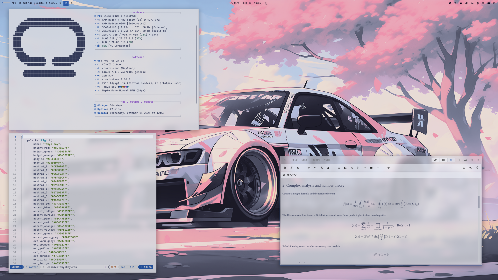
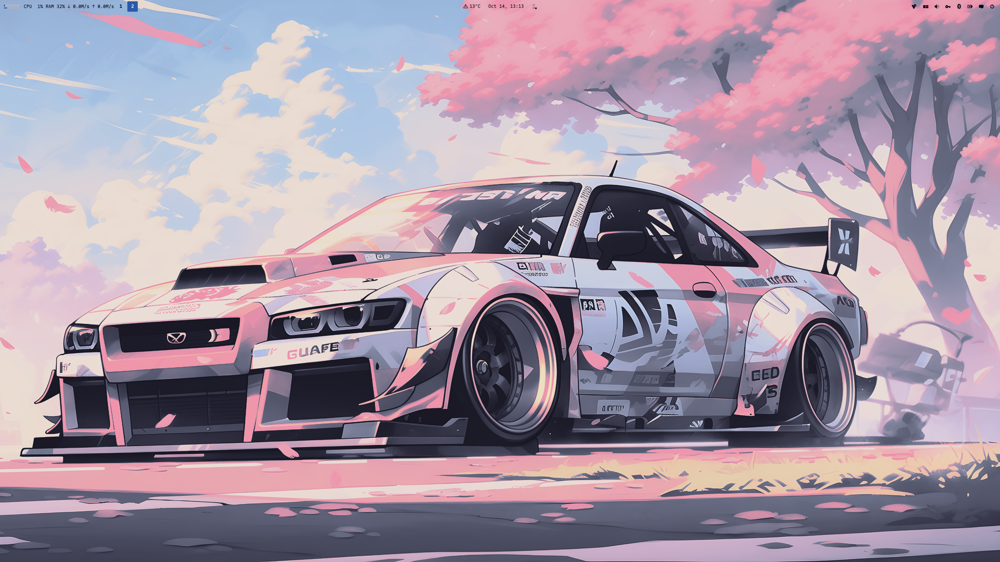

<div align="center">

# COSMIC · Tokyo Day

Pop!_OS 24.04 on COSMIC in Tokyo Night Light lavender grey, ink and blue: desktop,
terminal, shell, editor, Firefox, cursor, wallpapers. The light half of a pair;
the dark half is [cosmic-tokyonight-theme](https://github.com/atraxsrc/cosmic-tokyonight-theme).


</div>

---


## Palette

Tokyo Night Light from the [Tokyo Night VS Code theme](https://github.com/tokyo-night/tokyo-night-vscode-theme),
the same project the dark half cites. Body text is navy ink, so no role needed
re-tinting: everything you read as text is 4.5:1 or better on the window
background `#E6E7ED`. Muted and comment sit low on purpose, as upstream does.
The terminal is an opaque pane `#D6D8DF`, a step darker than the desktop,
where yellow, purple, cyan and the number colour land between 3.9 and 4.4:1.

| Role | Color | Hex |
|------|-------|-----|
| Background |  Lavender grey | `#E6E7ED` |
| Containers |  Mist / Pane | `#DEE0E6` / `#D6D8DF` |
| Terminal |  Pane, opaque | `#D6D8DF` |
| Text |  Ink | `#343B59` |
| Accent |  Blue | `#2959AA` |
| Success |  Green | `#33635C` |
| Warning |  Yellow | `#8F5E15` |
| Error |  Red | `#8C4351` |
| Purple |  Violet | `#7B43BA` |
| Cyan |  Teal | `#006C86` |
| String |  Moss | `#385F0D` |
| Number |  Umber | `#965027` |
| Keyword |  Grape | `#65359D` |
| Muted |  Slate | `#707280` |
| Comment |  Grey | `#888B94` |
| Faint |  btop inactive text | `#9DA0AB` |

Window hint `#2959AA`. Ratios per role are in `docs/showcase.md`, or run
`python3 scripts/contrast.py`.

| Role | Tokyo Day | Tokyo Night |
|------|-----------|-------------|
| Background | `#E6E7ED` | `#1A1B26` |
| Text | `#343B59` | `#C0CAF5` |
| Accent | `#2959AA` | `#7AA2F7` |
| Success | `#33635C` | `#9ECE6A` |

---

## Repo Structure

```
.
├── btop
│   └── TokyoDay.theme            # btop colour theme
├── claude-desktop
│   ├── cosmic-tokyo-night.jsonc # Claude Desktop theme (claude-desktop-extra), dark + light
│   └── install.sh
├── cosmic
│   ├── TokyoDay.ron              # COSMIC Appearance import (Light)
│   ├── config/                  # baseline settings: fonts, icons, terminal look
│   └── install.sh
├── cosmic-term
│   └── TokyoDay-term.ron         # COSMIC Terminal colour scheme (Light)
├── cursors
│   ├── Oxygen-TokyoDay-*/         # cursor themes, one per icon colour, patched for COSMIC apps
│   ├── install.sh
│   ├── uninstall.sh
│   └── README.md
├── icons
│   └── install.sh               # Cosmic-TokyoDay icon pack from cosmic-icon-themes
├── fastfetch
│   ├── config.jsonc             # ink / blue fastfetch config
│   ├── cosmic.txt               # COSMIC logo
│   └── install.sh
├── firefox
│   ├── theme                    # Cosmic Tokyo Day theme add-on (manifest + icons)
│   ├── chrome
│   │   ├── userChrome.css       # rounded chrome, grey menus, blue hover
│   │   └── userContent.css      # new tab accents, blank tiles
│   ├── install.sh
│   └── README.md
├── lsd
│   ├── config.yaml              # theme: custom
│   ├── colors.yaml              # permission / size / date / git columns
│   └── install.sh
├── nvim                         # Neovim colorscheme, LazyVim spec, RON syntax, install.sh
├── scripts
│   ├── update_system.sh         # nala + flatpak, dark ANSI for a light terminal
│   └── contrast.py              # palette contrast table, feeds the README
├── zsh
│   ├── tokyoday.zsh              # LS_COLORS, highlighting colours, aliases, starship
│   └── install.sh
├── assets
│   ├── cursors/                 # cursor preview
│   ├── screenshot.png           # README screenshot
│   └── wallpaper.png            # the car on the bare desktop
├── backgrounds/                 # wallpapers, tokyoday-<subject>.png (see Icons and wallpaper)
├── docs
│   └── showcase.md              # the rice describing itself, for the Postilla pane of the screenshot
├── LICENSE
└── README.md
```

---

## COSMIC Desktop

This is a **Light** theme, so it goes in COSMIC's Light slot:

Settings → Desktop → Appearance → **Light** → **Import** → `cosmic/TokyoDay.ron`

Accent is blue `#2959AA`; the window hint border is the same blue, matching
the dark half.
Use the `+` control if you want a custom swatch.

Frosted glass is on in the `.ron` at `frosted: Low` with an opacity table of
0.66 to 0.96, tinted with the palette's middle neutral `#898EA0`, for windows, panel,
applets and system UI (maximized apps stay solid), and corners are squared
(`radius_*: 2.0`), the same as the DarkGold baseline. Adjust frosted glass on
Appearance → Style → Frosted glass after import; those sliders survive a theme switch.

**Known COSMIC bug:** moving the frosted glass opacity / thickness sliders can
reset `text_tint` to `#FFFFFF`, which on a light theme makes every label
unreadable. If your text turns white, re-import `cosmic/TokyoDay.ron`: it
carries the ink tint and the whole frosted block, so one import restores both.
Upstream fix proposed in [libcosmic#1450](https://github.com/pop-os/libcosmic/pull/1450),
not merged.

Export from Appearance if you tweak backgrounds / tints so you do not lose them.

Pairing tip: import `TokyoNight.ron` from
[cosmic-tokyonight-theme](https://github.com/atraxsrc/cosmic-tokyonight-theme) into the
Dark slot and COSMIC's Dark / Light toggle flips between the two. Wallpaper,
Firefox and the shell layer do not follow the toggle; those are per-rice files.

### Baseline settings

`cosmic/config/` holds the settings that make up the look and rarely change
(panel, dock, applets and shortcuts are left out on purpose):

| Where | Setting |
|-------|---------|
| Fonts | Interface `Maple Normal UI`, monospace `Maple Mono Normal NFM` |
| Icons | Cosmic-TokyoDay-Blue |
| Windows | Minimize / maximize buttons hidden, theme applied to GNOME apps |
| Terminal | Maple Mono 15 (weights 500 / bold 800 / dim 300), opaque, no header bar, Tokyo Day (light scheme) |

Install the [Maple fonts](https://github.com/subframe7536/maple-font) and the
Cosmic-TokyoDay icons (see Icons below) and import the terminal scheme first, then:

```bash
./cosmic/install.sh
```

It backs up each file it replaces to `*.bak` and COSMIC applies it live.

---

## COSMIC Terminal

The desktop `.ron` does not colour ANSI text.

1. COSMIC Terminal → **View → Color schemes…** (not Settings → Appearance)
2. **Light** tab → **Import** → `cosmic-term/TokyoDay-term.ron`
3. View → Settings → Appearance → Color scheme (light) → **Tokyo Day**

If a profile is set as default, set the scheme on that profile too or the
dropdown will look like it did nothing.

Ink text on an opaque pane `#D6D8DF`, a step darker than the desktop; red for
errors, green for strings and success, yellow in its own slot, blue for
commands and directories, cyan for symlinks, purple for magenta. Bright colours
are deeper, dim colours lighter, so bold and dim still read on a light
background. On the pane yellow, purple, cyan and the number colour land between
3.9 and 4.4:1, a little under the 4.5:1 the window background keeps; drop the
`background` line from the scheme to get the window colour back.

---

## Firefox

Two layers:

1. **Theme (colours):** install
   **[cosmic-tokyoday-theme on addons.mozilla.org](https://addons.mozilla.org/en-US/firefox/addon/cosmic-tokyoday-theme/)**.
   This is the main look.
2. **Stylesheets (optional):** `firefox/chrome/` adds rounded corners, blue
   menu hover, blue accents and blank new-tab tiles on top of the add-on
   (they also work with Firefox's built-in Light theme):

```bash
./firefox/install.sh
```

Fully quit Firefox afterward. Details and CSS rules: [`firefox/README.md`](firefox/README.md).

---

## Claude Desktop

For the unofficial [claude-desktop-extra](https://github.com/patrickjaja/claude-desktop-extra)
Linux build. `claude-desktop/cosmic-tokyo-night.jsonc` is one theme with both halves:
Tokyo Night in dark mode and Tokyo Day in light mode, so Claude's own
Settings → Appearance toggle switches between the two rices.
Colours come from `cosmic/*.ron`, contrast-checked (text and button text
4.5:1, accents 3:1).

```bash
./claude-desktop/install.sh
```

It copies the file into `~/.config/Claude/themes.d/`. Then press
<kbd>Ctrl</kbd>+<kbd>Shift</kbd>+<kbd>T</kbd> in Claude Desktop and pick **cosmic-tokyo-night**.

The same file ships in [`cosmic-tokyonight-theme`](https://github.com/atraxsrc/cosmic-tokyonight-theme),
so installing from either repo gives the same theme.

---

## Cursor

**Oxygen** cursors recoloured to the icon colours, one per folder colour of the
Cosmic-TokyoDay icon pack: **Blue** (default), **Purple**, **Green**, **Ink**. Patched with the cursor
names COSMIC apps ask for. COSMIC has no cursor picker yet, so the script sets it:

```bash
./cursors/install.sh                      # Blue
./cursors/install.sh --variant Purple    # or another, see --list
reboot
```

Previews, what the script touches, how to undo it and how the colours are made:
[`cursors/README.md`](cursors/README.md).

---

## Scripts

### `update_system.sh`

nala + flatpak updater. Headers in ink, info in blue, success in green,
errors in red; the banner ramps from ink to blue. All dark enough for a light
terminal.

```bash
chmod +x scripts/update_system.sh
./scripts/update_system.sh
```

---

## Terminal extras

Need a [Nerd Font](https://www.nerdfonts.com/) in the terminal for the icons
(Maple Mono NFM in the baseline above).

### zsh

`zsh/tokyoday.zsh` is the rice part of the shell only: `LS_COLORS` (also used
by lsd for file names and by the completion menu), blue / green / red colours
for zsh-autosuggestions and zsh-syntax-highlighting, lsd / bat / nvim aliases
and the starship prompt. Your own `~/.zshrc` stays private and sources it.

Needs zsh + [oh-my-zsh](https://ohmyz.sh/). `install.sh` clones the two
plugins if missing and appends one `source` line to `~/.zshrc` (backup in
`~/.zshrc.bak`):

```bash
./zsh/install.sh
exec zsh
```

In `~/.zshrc` keep `ZSH_THEME=""` and
`plugins=(git sudo zsh-autosuggestions zsh-syntax-highlighting)`.

### lsd

File names are coloured by `LS_COLORS` from `zsh/tokyoday.zsh`;
`lsd/colors.yaml` colours the other columns with the 256-colour codes nearest
the palette (25 blue, 24 cyan, 23 green, 94 yellow, 95 red, 97 purple,
243 muted, 245 comment, 238 ink). lsd 1.0.0 does not accept `#hex` there.

```bash
./lsd/install.sh
lsd -l
```

### fastfetch

COSMIC logo in ink, Hardware / Software / Age boxes in pale grey with blue
keys. `install.sh` backs up any existing `~/.config/fastfetch/config.jsonc`
to `config.jsonc.bak`.

```bash
./fastfetch/install.sh
fastfetch
```

### Neovim

`nvim/` carries the rice into Neovim: a dependency-free colorscheme built from
the palette (`nvim/colors/tokyoday.lua`), a LazyVim spec that selects it and makes
sure the treesitter parsers for the files in this repo are installed
(`nvim/lua/plugins/tokyoday.lua`), and a small RON syntax file so `cosmic/*.ron`
is coloured even before the parser exists. `:terminal` inside Neovim uses the
Tokyo Day scheme.

```bash
./nvim/install.sh
# restart nvim; LazyVim switches to the tokyoday colorscheme
```

Without LazyVim, copy `nvim/colors/tokyoday.lua` to `~/.config/nvim/colors/` and
run `:colorscheme tokyoday`.

### btop

`btop/TokyoDay.theme`: terminal background, ink boxes, blue highlights,
meters ramp from green through blue to red.

```bash
mkdir -p ~/.config/btop/themes
cp btop/TokyoDay.theme ~/.config/btop/themes/
# btop → Esc → Options → Color theme → Tokyo Day
```

---

## Icons and wallpaper

Icons: **Cosmic-TokyoDay**, the [Kanagawa icons](https://github.com/Fausto-Korpsvart/Kanagawa-GKT-Theme/tree/main/icons/Kanagawa)
by Fausto Korpsvart recolored to this palette in
[cosmic-icon-themes](https://github.com/atraxsrc/cosmic-icon-themes). Folders come in
four colors: **Blue** `#2959AA` (default), **Purple** `#7B43BA`, **Green** `#33635C` and **Ink** `#343B59` with blue symbols.


```bash
./icons/install.sh                  # Blue folders
./icons/install.sh --variant Purple # or Green, Ink
```

It downloads the pack from the latest cosmic-icon-themes release, checks its SHA256,
installs it to `~/.local/share/icons/` and sets it as the COSMIC icon theme.
Restart open apps afterwards (Files caches icons per window).
Add `--system` to install to `/usr/share/icons` instead, for every user and the
login screen (asks for sudo); `--user` is the default.

Wallpapers ship in [`backgrounds/`](backgrounds/), named `tokyoday-<subject>.png`:
a car (the one in the screenshot), a city, a city on water and the Hyundai
blueprint, recoloured in GIMP with `tokyoday.gpl`, the palette file next to
them. More subjects (eagle, samurai, reaper, geisha, sushi switch) land as
they are rendered.

Settings → Wallpaper → Add image → a file from `backgrounds/`.



---

## Setup

```bash
git clone https://github.com/atraxsrc/cosmic-tokyoday-theme.git
cd cosmic-tokyoday-theme

# desktop
# Settings → Appearance → Light → Import cosmic/TokyoDay.ron

# terminal
# View → Color schemes → Light tab → Import cosmic-term/TokyoDay-term.ron

# firefox add-on
# https://addons.mozilla.org/en-US/firefox/addon/cosmic-tokyoday-theme/

# optional extra chrome
./firefox/install.sh

# claude desktop (claude-desktop-extra), then Ctrl+Shift+T
./claude-desktop/install.sh

# cursor (then reboot), see cursors/README.md
./cursors/install.sh                      # Blue
./cursors/install.sh --variant Purple    # or another, see --list
reboot

# shell + terminal tools (see Terminal extras above)
./zsh/install.sh
./lsd/install.sh
./fastfetch/install.sh
./nvim/install.sh
mkdir -p ~/.config/btop/themes && cp btop/TokyoDay.theme ~/.config/btop/themes/

# wallpaper
# Settings → Wallpaper → Add image → a file from backgrounds/ (see Icons and wallpaper above)

./icons/install.sh                  # icons (see Icons above)
# Maple fonts (https://github.com/subframe7536/maple-font), then
# fonts, icons, terminal look from cosmic/config/
./cosmic/install.sh
```

---

## Stack

| Tool | What it does |
|------|-------------|
| [Pop!_OS 24.04](https://pop.system76.com/) | Base OS by System76 |
| [COSMIC DE](https://system76.com/cosmic) | Desktop environment |
| [oh-my-zsh](https://ohmyz.sh/) | zsh framework + plugins |
| [lsd](https://github.com/lsd-rs/lsd) | `ls` with icons and colours |
| [fastfetch](https://github.com/fastfetch-cli/fastfetch) | System info |
| [btop](https://github.com/aristocratos/btop) | Resource monitor |
| [cosmic-icon-themes](https://github.com/atraxsrc/cosmic-icon-themes) | Icon pack (Cosmic-TokyoDay), recolored from [Kanagawa icons](https://github.com/Fausto-Korpsvart/Kanagawa-GKT-Theme/tree/main/icons/Kanagawa) |
| [Oxygen-Cursors](https://github.com/wo2ni/Oxygen-Cursors) | Cursor, recoloured to the icon colours |

## Credits

- Palette: Tokyo Night Light from
  [tokyo-night-vscode-theme](https://github.com/tokyo-night/tokyo-night-vscode-theme) (MIT).
  This repo is a COSMIC port; the ANSI set is upstream's, bright and dim are
  derived from it.
- Dark half: [cosmic-tokyonight-theme](https://github.com/atraxsrc/cosmic-tokyonight-theme).
  Shared baseline (frosted glass, squared corners, fonts) from
  [cosmic-darkgold-theme](https://github.com/atraxsrc/cosmic-darkgold-theme).

## License

MIT. The cursor artwork keeps the terms of KDE's Oxygen project, see
[`cursors/README.md`](cursors/README.md).
