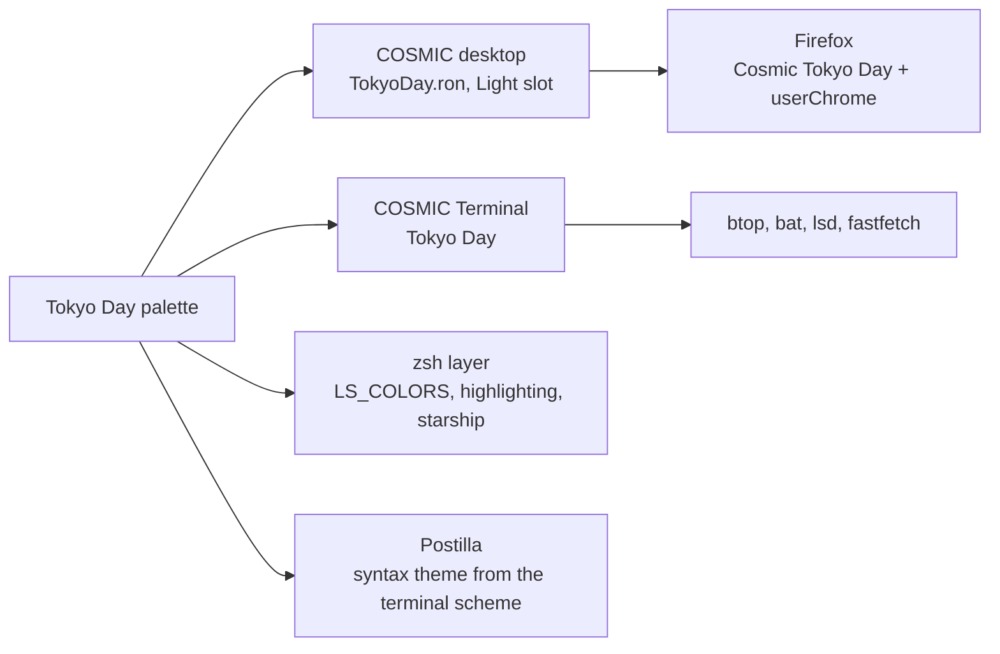

# Tokyo Day Implementation Plan

> **For agentic workers:** REQUIRED SUB-SKILL: Use superpowers:subagent-driven-development (recommended) or superpowers:executing-plans to implement this plan task-by-task. Steps use checkbox (`- [ ]`) syntax for tracking.

**Goal:** Build cosmic-tokyoday-theme, the Light-slot sibling of cosmic-tokyonight-theme, with every component of the template repos converted to the Tokyo Night Light palette.

**Architecture:** A fresh git repo seeded from the dark repo's tree, renamed, then each component rewritten against the spec's colour tables. Every component is a standalone config file plus an installer, so tasks are independent after the seed. One small Python script checks contrast so the README numbers cannot drift.

**Tech Stack:** COSMIC RON theme files, COSMIC Terminal colour schemes, bash installers, Lua (Neovim), YAML (lsd), JSONC (fastfetch), Firefox WebExtension theme manifest and userChrome CSS, Python 3 (contrast check, cursor recolour, icon pack build), ImageMagick 6 (`convert`).

**Spec:** `docs/superpowers/specs/2026-10-14-tokyoday-design.md`

## Global Constraints

- Repo path: `/home/0xdev1/Documents/projects/repos/github/cosmic-tokyoday-theme`. Template repos are siblings under `/home/0xdev1/Documents/projects/repos/github/`: `cosmic-tokyonight-theme`, `cosmic-dossier-theme`, `cosmic-darkgold-theme`, `cosmic-icon-themes`.
- Names: COSMIC palette `Tokyo-Day`; terminal scheme and syntax theme `Tokyo Day`; files `TokyoDay.*`; scripts and lowercase names `tokyoday`; icon packs `Cosmic-TokyoDay-<Variant>`; cursors `Oxygen-TokyoDay-<Variant>`; Firefox theme `Cosmic Tokyo Day`.
- Palette, verbatim from the spec: window `#E6E7ED`, primary container `#DEE0E6`, pane and secondary container `#D6D8DF`, ink `#343B59`, deep ink `#2C324B`, blue `#2959AA`, green `#33635C`, yellow `#8F5E15`, red `#8C4351`, purple `#7B43BA`, cyan `#006C86`, muted `#707280`, comment `#888B94`, faint `#9DA0AB`, string `#385F0D`, number `#965027`, keyword `#65359D`, box lines `#A5A9B7`, neutral tint `#898EA0`.
- Window hint is the accent `#2959AA`. Terminal is opaque (`opacity` 100) with its own background `#D6D8DF`.
- No em-dashes or en-dashes anywhere, in files, commit messages or prose. Plain hyphens only.
- Commits: author must match the sibling repos. Read it with `git -C ../cosmic-dossier-theme log --format='%an <%ae>' -1` and pass it per command as `git -c user.name=... -c user.email=... commit`. No `Co-Authored-By` trailer. Never `git push`; the user pushes.
- If `git` fails with "unable to access ~/.gitconfig", prefix every git command with `HOME=$TMPDIR`.
- Bash scripts keep `set -euo pipefail` (or `set -e` where the template has it) and the `.bak` backup behaviour of the template.
- Nothing is written under `~/.config` by the implementer. Installers are run by the user.

## Review Focus

- A ron missing any frosted key: COSMIC Settings imports it, the user drags the frosted slider, text turns white (libcosmic pull 1450). Task 3 greps for every key.
- Terminal scheme without `background`: the pane follows the window colour and the Dossier lesson is lost. Task 4 greps for it.
- A leftover `TokyoNight` or `tokyonight` string in a script variable: the installer downloads or activates the dark pack. Task 1 and Task 16 grep the whole tree.
- A colour under 4.5:1 used for body text: Task 2's script fails on any "reads" role below 4.5 on the window.
- Fastfetch config with a trailing comma or a bad escape: fastfetch prints nothing. Task 6 parses it with `python3 -m json.tool`.

---

### Task 1: Seed the repo from the dark sibling and rename

**Files:**
- Create: the whole tree under `cosmic-tokyoday-theme/` (copied), `.git/`
- Modify: every text file containing the old names

**Interfaces:**
- Produces: a git repo on `master` with the template layout, every file still in Tokyo Night colours but already named Tokyo Day. Later tasks replace content file by file.

- [ ] **Step 1: Copy the tree**

```bash
cd /home/0xdev1/Documents/projects/repos/github
SRC=cosmic-tokyonight-theme; DST=cosmic-tokyoday-theme
rsync -a --exclude .git --exclude assets --exclude backgrounds --exclude 'cursors/Oxygen-TokyoNight-*' "$SRC/" "$DST/"
mkdir -p "$DST/assets/cursors" "$DST/backgrounds"
ls "$DST"
```

Expected: `btop cosmic cosmic-term cursors docs fastfetch firefox icons lsd nvim scripts zsh .gitignore .pre-commit-config.yaml LICENSE README.md`, plus `docs/superpowers/`.

- [ ] **Step 2: Rename files**

```bash
cd /home/0xdev1/Documents/projects/repos/github/cosmic-tokyoday-theme
mv btop/TokyoNight.theme btop/TokyoDay.theme
mv cosmic/TokyoNight.ron cosmic/TokyoDay.ron
mv cosmic-term/TokyoNight-term.ron cosmic-term/TokyoDay-term.ron
mv cosmic/config/com.system76.CosmicTerm/v1/syntax_theme_dark cosmic/config/com.system76.CosmicTerm/v1/syntax_theme_light
mv nvim/colors/tokyonight.lua nvim/colors/tokyoday.lua
mv nvim/lua/plugins/tokyonight.lua nvim/lua/plugins/tokyoday.lua
mv zsh/tokyonight.zsh zsh/tokyoday.zsh
find . -type f -not -path './.git/*' | sort
```

Expected: no path contains `tokyonight` or `TokyoNight`.

- [ ] **Step 3: Rename inside files**

```bash
cd /home/0xdev1/Documents/projects/repos/github/cosmic-tokyoday-theme
grep -rlE 'TokyoNight|tokyonight|Tokyo Night|Tokyo-Night' . --exclude-dir=.git --exclude-dir=superpowers | xargs sed -i \
  -e 's/Tokyo-Night/Tokyo-Day/g' -e 's/Tokyo Night/Tokyo Day/g' -e 's/TokyoNight/TokyoDay/g' -e 's/tokyonight/tokyoday/g'
grep -rnE 'TokyoNight|tokyonight|Tokyo Night' . --exclude-dir=.git --exclude-dir=superpowers || echo "no leftovers"
```

Expected: `no leftovers`. (The README still describes the dark theme; Task 15 rewrites it. The spec and plan under `docs/superpowers/` are excluded on purpose.)

- [ ] **Step 4: Fix the two places where the rename is wrong**

The icon theme name and the README credits will be rewritten later, but two values must be right now so nothing installs the dark pack by accident:

```bash
cd /home/0xdev1/Documents/projects/repos/github/cosmic-tokyoday-theme
printf '"Cosmic-TokyoDay-Blue"' > cosmic/config/com.system76.CosmicTk/v1/icon_theme
printf '"Tokyo Day"' > cosmic/config/com.system76.CosmicTerm/v1/syntax_theme_light
printf '100' > cosmic/config/com.system76.CosmicTerm/v1/opacity
cat cosmic/config/com.system76.CosmicTk/v1/icon_theme; echo; cat cosmic/config/com.system76.CosmicTerm/v1/syntax_theme_light; echo; cat cosmic/config/com.system76.CosmicTerm/v1/opacity; echo
```

Expected: `"Cosmic-TokyoDay-Blue"`, `"Tokyo Day"`, `100`.

- [ ] **Step 5: Init and first commit**

```bash
cd /home/0xdev1/Documents/projects/repos/github/cosmic-tokyoday-theme
git init -q -b master
git add -A
git -c user.name='<from sibling>' -c user.email='<from sibling>' commit -q -m "Tokyo Day: COSMIC light rice, sibling of cosmic-tokyonight-theme

Seeded from the dark repo's layout and renamed. Colours follow in
per-component commits."
git log --oneline
```

Expected: one commit on `master`.

---

### Task 2: Contrast check script

**Files:**
- Create: `scripts/contrast.py`

**Interfaces:**
- Produces: `python3 scripts/contrast.py` prints a Markdown table of every role with its ratio on the window and on the pane and exits 1 if a role marked `reads` is under 4.5 on the window. Tasks 15 and 16 use its output.

- [ ] **Step 1: Write the script**

```python
#!/usr/bin/env python3
"""Tokyo Day palette contrast table. Exit 1 if a readable role is under 4.5:1 on the window."""
import sys

WINDOW = "#E6E7ED"
PANE = "#D6D8DF"

# (role, hex, reads) where reads=True means a user reads it as text.
ROLES = [
    ("Text, ink", "#343B59", True),
    ("Accent, blue", "#2959AA", True),
    ("Success, green", "#33635C", True),
    ("Warning, yellow", "#8F5E15", True),
    ("Error, red", "#8C4351", True),
    ("Purple", "#7B43BA", True),
    ("Cyan", "#006C86", True),
    ("String", "#385F0D", True),
    ("Number", "#965027", True),
    ("Keyword", "#65359D", True),
    ("Muted", "#707280", False),
    ("Comment", "#888B94", False),
    ("Line numbers", "#9DA0AB", False),
]


def lum(h):
    r, g, b = (int(h[i:i + 2], 16) / 255 for i in (1, 3, 5))
    f = lambda c: c / 12.92 if c <= 0.03928 else ((c + 0.055) / 1.055) ** 2.4
    return 0.2126 * f(r) + 0.7152 * f(g) + 0.0722 * f(b)


def ratio(a, b):
    la, lb = sorted((lum(a), lum(b)), reverse=True)
    return (la + 0.05) / (lb + 0.05)


def main():
    bad = []
    print("| Role | Hex | On window | On pane |")
    print("|------|-----|-----------|---------|")
    for role, hexv, reads in ROLES:
        w, p = ratio(hexv, WINDOW), ratio(hexv, PANE)
        print(f"| {role} | `{hexv}` | {w:.1f} | {p:.1f} |")
        if reads and w < 4.5:
            bad.append((role, w))
    for role, w in bad:
        print(f"FAIL {role} {w:.1f} < 4.5 on window", file=sys.stderr)
    return 1 if bad else 0


if __name__ == "__main__":
    sys.exit(main())
```

- [ ] **Step 2: Run it**

```bash
cd /home/0xdev1/Documents/projects/repos/github/cosmic-tokyoday-theme
chmod +x scripts/contrast.py && python3 scripts/contrast.py; echo "exit $?"
```

Expected: a 13-row table, ink 8.9 / 7.7, yellow 4.5 / 3.9, comment 2.8 / 2.4, and `exit 0`.

- [ ] **Step 3: Commit**

```bash
git add scripts/contrast.py && git -c user.name='<from sibling>' -c user.email='<from sibling>' commit -q -m "scripts: contrast table for the Tokyo Day palette"
```

---

### Task 3: COSMIC appearance ron and baseline config

**Files:**
- Modify: `cosmic/TokyoDay.ron` (replace whole file)
- Modify: `cosmic/install.sh` (text only)
- Verify: `cosmic/config/**`

**Interfaces:**
- Produces: `cosmic/TokyoDay.ron`, importable into the Light slot. README (Task 15) refers to it by that path.

- [ ] **Step 1: Write the ron**

Replace the whole file with:

```ron
(
    palette: Light((
        name: "Tokyo-Day",
        bright_red: "#8C4351FF",
        bright_green: "#33635CFF",
        bright_orange: "#965027FF",
        gray_1: "#DEE0E6FF",
        gray_2: "#D6D8DFFF",
        neutral_0: "#DEE0E6FF",
        neutral_1: "#CDD0D8FF",
        neutral_2: "#BCBFCAFF",
        neutral_3: "#ABAEBCFF",
        neutral_4: "#9A9EAEFF",
        neutral_5: "#898EA0FF",
        neutral_6: "#787D91FF",
        neutral_7: "#676D83FF",
        neutral_8: "#565C75FF",
        neutral_9: "#454C67FF",
        neutral_10: "#343B59FF",
        accent_blue: "#2959AAFF",
        accent_indigo: "#65359DFF",
        accent_purple: "#7B43BAFF",
        accent_pink: "#8C4351FF",
        accent_red: "#8C4351FF",
        accent_orange: "#965027FF",
        accent_yellow: "#8F5E15FF",
        accent_green: "#33635CFF",
        accent_warm_grey: "#707280FF",
        ext_warm_grey: "#707280FF",
        ext_orange: "#965027FF",
        ext_yellow: "#8F5E15FF",
        ext_blue: "#006C86FF",
        ext_purple: "#7B43BAFF",
        ext_pink: "#8C4351FF",
        ext_indigo: "#65359DFF",
    )),
    spacing: (
        space_none: 0,
        space_xxxs: 4,
        space_xxs: 8,
        space_xs: 12,
        space_s: 16,
        space_m: 24,
        space_l: 32,
        space_xl: 48,
        space_xxl: 64,
        space_xxxl: 128,
    ),
    corner_radii: (
        radius_0: (0.0, 0.0, 0.0, 0.0),
        radius_xs: (2.0, 2.0, 2.0, 2.0),
        radius_s: (2.0, 2.0, 2.0, 2.0),
        radius_m: (2.0, 2.0, 2.0, 2.0),
        radius_l: (2.0, 2.0, 2.0, 2.0),
        radius_xl: (2.0, 2.0, 2.0, 2.0),
    ),
    neutral_tint: Some("#898EA0FF"),
    bg_color: Some("#E6E7EDFF"),
    primary_container_bg: Some("#DEE0E6FF"),
    secondary_container_bg: Some("#D6D8DFFF"),
    text_tint: Some("#343B59FF"),
    accent: Some("#2959AAFF"),
    success: Some("#33635CFF"),
    warning: Some("#8F5E15FF"),
    destructive: Some("#8C4351FF"),
    frosted: Low,
    gaps: (0, 7),
    active_hint: 1,
    window_hint: Some("#2959AAFF"),
    frosted_windows: true,
    frosted_system_interface: true,
    frosted_panel: true,
    frosted_applets: true,
    frosted_maximized_apps: false,
    alpha_map: (
        extremely_low: 0.96,
        extremely_low_2: 0.93692,
        very_low: 0.91385,
        very_low_2: 0.89076,
        low: 0.86769,
        low_2: 0.84461,
        medium: 0.82154,
        medium_2: 0.79846,
        high: 0.77538,
        high_2: 0.75231,
        very_high: 0.72023,
        very_high_2: 0.70615,
        extremely_high: 0.68308,
        extremely_high_2: 0.66,
    ),
)
```

- [ ] **Step 2: Check every frosted and tint key is present**

```bash
cd /home/0xdev1/Documents/projects/repos/github/cosmic-tokyoday-theme
for k in text_tint neutral_tint 'frosted:' frosted_windows frosted_system_interface frosted_panel frosted_applets frosted_maximized_apps window_hint; do grep -q "$k" cosmic/TokyoDay.ron && echo "ok $k" || echo "MISSING $k"; done
echo "alpha keys: $(grep -cE '^\s+(extremely|very|low|medium|high)' cosmic/TokyoDay.ron)"
grep -c 'Light((' cosmic/TokyoDay.ron
```

Expected: nine `ok` lines, `alpha keys: 14`, `1`.

- [ ] **Step 3: Check the baseline config and installer text**

```bash
cd /home/0xdev1/Documents/projects/repos/github/cosmic-tokyoday-theme
for f in cosmic/config/com.system76.CosmicTerm/v1/* cosmic/config/com.system76.CosmicTk/v1/*; do printf '%s = ' "${f#cosmic/config/}"; cat "$f"; echo; done
grep -n 'Day\|icons' cosmic/install.sh; bash -n cosmic/install.sh && echo "syntax ok"
```

Expected: `opacity = 100`, `syntax_theme_light = "Tokyo Day"`, `icon_theme = "Cosmic-TokyoDay-Blue"`, fonts Maple as in the template, no `syntax_theme_dark` file, `syntax ok`. If `cosmic/install.sh` still says "Cosmic-TokyoDay icons" only in prose, leave it.

- [ ] **Step 4: Commit**

```bash
git add cosmic && git -c user.name='<from sibling>' -c user.email='<from sibling>' commit -q -m "cosmic: Tokyo Day appearance ron, Light slot, frosted block and ink text tint pinned"
```

---

### Task 4: COSMIC Terminal scheme

**Files:**
- Modify: `cosmic-term/TokyoDay-term.ron` (replace whole file)

**Interfaces:**
- Produces: scheme named `Tokyo Day`, the name `syntax_theme_light` and the Neovim `:terminal` colours (Task 9) rely on.

- [ ] **Step 1: Write the scheme**

```ron
(
    name: "Tokyo Day",
    foreground: "#343B59",
    background: "#D6D8DF",
    cursor: "#2959AA",
    bright_foreground: "#2C324B",
    dim_foreground: "#707280",
    normal: (
        black: "#343B58",
        red: "#8C4351",
        green: "#33635C",
        yellow: "#8F5E15",
        blue: "#2959AA",
        magenta: "#7B43BA",
        cyan: "#006C86",
        white: "#707280",
    ),
    bright: (
        black: "#2C324B",
        red: "#773945",
        green: "#2B544E",
        yellow: "#7A5012",
        blue: "#234C90",
        magenta: "#69399E",
        cyan: "#005C72",
        white: "#5F616D",
    ),
    dim: (
        black: "#757A8E",
        red: "#AA7F8A",
        green: "#749290",
        yellow: "#AB8F66",
        blue: "#6E8CBF",
        magenta: "#9F7FC9",
        cyan: "#5697AA",
        white: "#999BA6",
    ),
)
```

- [ ] **Step 2: Check**

```bash
cd /home/0xdev1/Documents/projects/repos/github/cosmic-tokyoday-theme
grep -c 'background: "#D6D8DF"' cosmic-term/TokyoDay-term.ron; grep -c '"#' cosmic-term/TokyoDay-term.ron
```

Expected: `1` and `29` (5 header colours + 24 slots).

- [ ] **Step 3: Commit**

```bash
git add cosmic-term && git -c user.name='<from sibling>' -c user.email='<from sibling>' commit -q -m "cosmic-term: Tokyo Day scheme, opaque pane, deeper bright and lighter dim"
```

---

### Task 5: btop theme

**Files:**
- Modify: `btop/TokyoDay.theme` (replace whole file)

- [ ] **Step 1: Write the theme**

```
# Main background, empty so it follows the terminal pane (#D6D8DF)
theme[main_bg]=""

# Main text color
theme[main_fg]="#343B59"

# Title color for boxes
theme[title]="#2C324B"

# Highlight color for keyboard shortcuts
theme[hi_fg]="#2959AA"

# Background color of selected item in processes box
theme[selected_bg]="#2959AA"

# Foreground color of selected item in processes box
theme[selected_fg]="#D6D8DF"

# Color of inactive/disabled text
theme[inactive_fg]="#9DA0AB"

# Misc colors for processes box including mini cpu graphs, details memory graph and details status text
theme[proc_misc]="#2959AA"

# Box outline and divider line color
theme[cpu_box]="#2C324B"
theme[mem_box]="#2C324B"
theme[net_box]="#2C324B"
theme[proc_box]="#2C324B"
theme[div_line]="#888B94"

# Gradient for all meters and graphs: green -> blue -> red
theme[temp_start]="#33635C"
theme[temp_mid]="#2959AA"
theme[temp_end]="#8C4351"

theme[cpu_start]="#33635C"
theme[cpu_mid]="#2959AA"
theme[cpu_end]="#8C4351"

theme[free_start]="#33635C"
theme[free_mid]="#2959AA"
theme[free_end]="#8C4351"

theme[cached_start]="#8F5E15"
theme[cached_mid]="#8F5E15"
theme[cached_end]="#8F5E15"

theme[available_start]="#006C86"
theme[available_mid]="#006C86"
theme[available_end]="#006C86"

theme[used_start]="#8C4351"
theme[used_mid]="#8C4351"
theme[used_end]="#8C4351"

theme[download_start]="#33635C"
theme[download_mid]="#2959AA"
theme[download_end]="#8C4351"

theme[upload_start]="#33635C"
theme[upload_mid]="#2959AA"
theme[upload_end]="#8C4351"
```

- [ ] **Step 2: Check**

```bash
cd /home/0xdev1/Documents/projects/repos/github/cosmic-tokyoday-theme
grep -c '^theme\[' btop/TokyoDay.theme; grep -E '^theme\[main_bg\]' btop/TokyoDay.theme
```

Expected: `38` and `theme[main_bg]=""`.

- [ ] **Step 3: Commit**

```bash
git add btop && git -c user.name='<from sibling>' -c user.email='<from sibling>' commit -q -m "btop: Tokyo Day theme on the terminal pane"
```

---

### Task 6: fastfetch

**Files:**
- Modify: `fastfetch/config.jsonc` (colour values and the palette line)
- Keep: `fastfetch/cosmic.txt`, `fastfetch/install.sh`

- [ ] **Step 1: Replace every colour sequence**

The template uses truecolor sequences `38;2;R;G;B`. Replace them by role. Run:

```bash
cd /home/0xdev1/Documents/projects/repos/github/cosmic-tokyoday-theme
grep -oE '38;2;[0-9;]+' fastfetch/config.jsonc | sort | uniq -c
```

Then set, with `sed -i`, every occurrence so that the file has exactly these roles:

| Role | Sequence |
|------|----------|
| logo `"color": { "1": ... }` | `38;2;52;59;89` (ink) |
| `display.color.output` | `38;2;52;59;89` |
| every `keyColor` | `38;2;41;89;170` (blue) |
| box title words (`Hardware`, `Software`, `Age / Uptime / Update`) | `38;2;123;67;186` (purple) |
| box lines (`┌`, `└`, `─`) | `38;2;165;169;183` |

Because the dark template's sequences differ from Dossier's, do it by position rather than by old value: open the file, and for each JSON key above write the new sequence. The box-line and title sequences live inside the `"format"` strings of the `custom` modules as `\u001b[38;2;...m`.

Replace the palette command line's `text` with:

```
"text": "echo -n 'Tokyo Day '; for c in 52,59,89 41,89,170 51,99,92 143,94,21 140,67,81 123,67,186 0,108,134; do printf '\\033[38;2;%sm●' \"$(echo $c | tr , \;)\"; done"
```

- [ ] **Step 2: Check**

```bash
cd /home/0xdev1/Documents/projects/repos/github/cosmic-tokyoday-theme
python3 -m json.tool fastfetch/config.jsonc >/dev/null && echo "json ok"
grep -oE '38;2;[0-9;]+' fastfetch/config.jsonc | sort | uniq -c
grep -c "Tokyo Day" fastfetch/config.jsonc; bash -n fastfetch/install.sh && echo "sh ok"
```

Expected: `json ok`; exactly four distinct sequences: `52;59;89`, `41;89;170`, `123;67;186`, `165;169;183`; `1`; `sh ok`.

- [ ] **Step 3: Commit**

```bash
git add fastfetch && git -c user.name='<from sibling>' -c user.email='<from sibling>' commit -q -m "fastfetch: ink logo, blue keys, purple titles"
```

---

### Task 7: zsh layer

**Files:**
- Modify: `zsh/tokyoday.zsh` (replace the header and the two colour sections; keep aliases and prompt)
- Verify: `zsh/install.sh` (sources `tokyoday.zsh` after Task 1's rename)

- [ ] **Step 1: Replace the file header (everything before the `File colours` rule) with**

```zsh
# Tokyo Day zsh layer: colours, aliases, prompt.
#
# Source it at the END of your own ~/.zshrc, after oh-my-zsh.sh:
#   source /path/to/cosmic-tokyoday-theme/zsh/tokyoday.zsh
#
# Keep machine-specific or private lines (PATH, scaling, nvm, ...) in your
# own ~/.zshrc, not here.
#
#  pane:    #D6D8DF   fg:      #343B59   (terminal pane; window bg #E6E7ED)
#  blue:    #2959AA   green:   #33635C
#  yellow:  #8F5E15   red:     #8C4351
#  purple:  #7B43BA   cyan:    #006C86
#  muted:   #707280   comment: #888B94   string: #385F0D
#
# Light terminal: every colour here is dark enough to read on the pane.
```

- [ ] **Step 2: Replace the `LS_COLORS` line with**

```zsh
export LS_COLORS="di=1;38;2;41;89;170:ln=3;38;2;0;108;134:ex=1;38;2;51;99;92:*.zip=4;38;2;143;94;21:*.tar=4;38;2;143;94;21:*.gz=4;38;2;143;94;21:*.xz=4;38;2;143;94;21:*.7z=4;38;2;143;94;21:*.deb=4;38;2;143;94;21:*.png=38;2;123;67;186:*.jpg=38;2;123;67;186:*.jpeg=38;2;123;67;186:*.webp=38;2;123;67;186:*.gif=38;2;123;67;186:*.mp4=3;38;2;123;67;186:*.mkv=3;38;2;123;67;186:*.rs=38;2;51;99;92:*.py=38;2;51;99;92:*.js=38;2;51;99;92:*.ts=38;2;51;99;92:*.sh=38;2;51;99;92:*.md=38;2;52;59;89:*.txt=38;2;52;59;89:or=9;38;2;140;67;81"
```

- [ ] **Step 3: Replace the autosuggest and highlight block with**

```zsh
ZSH_AUTOSUGGEST_HIGHLIGHT_STYLE='fg=#9FA2AA'

typeset -gA ZSH_HIGHLIGHT_STYLES
ZSH_HIGHLIGHT_STYLES[command]='fg=#2959AA'
ZSH_HIGHLIGHT_STYLES[builtin]='fg=#2959AA'
ZSH_HIGHLIGHT_STYLES[alias]='fg=#2959AA'
ZSH_HIGHLIGHT_STYLES[function]='fg=#2959AA'
ZSH_HIGHLIGHT_STYLES[hashed-command]='fg=#2959AA'
ZSH_HIGHLIGHT_STYLES[suffix-alias]='fg=#2959AA,underline'
ZSH_HIGHLIGHT_STYLES[precommand]='fg=#33635C,underline'
ZSH_HIGHLIGHT_STYLES[reserved-word]='fg=#343B59,bold'
ZSH_HIGHLIGHT_STYLES[unknown-token]='fg=#8C4351,bold,underline'
ZSH_HIGHLIGHT_STYLES[path]='fg=#2C324B,underline'
ZSH_HIGHLIGHT_STYLES[globbing]='fg=#8F5E15'
ZSH_HIGHLIGHT_STYLES[history-expansion]='fg=#8F5E15'
ZSH_HIGHLIGHT_STYLES[single-hyphen-option]='fg=#707280'
ZSH_HIGHLIGHT_STYLES[double-hyphen-option]='fg=#707280'
ZSH_HIGHLIGHT_STYLES[single-quoted-argument]='fg=#385F0D'
ZSH_HIGHLIGHT_STYLES[double-quoted-argument]='fg=#385F0D'
ZSH_HIGHLIGHT_STYLES[dollar-quoted-argument]='fg=#385F0D'
ZSH_HIGHLIGHT_STYLES[commandseparator]='fg=#707280'
ZSH_HIGHLIGHT_STYLES[redirection]='fg=#707280'
ZSH_HIGHLIGHT_STYLES[comment]='fg=#888B94'
```

Keep the alias block and the starship line from the template unchanged. If the template's alias block differs from Dossier's, keep the template's.

- [ ] **Step 4: Check**

```bash
cd /home/0xdev1/Documents/projects/repos/github/cosmic-tokyoday-theme
zsh -n zsh/tokyoday.zsh && echo "zsh ok"; bash -n zsh/install.sh && echo "sh ok"
grep -c 'tokyoday.zsh' zsh/install.sh
grep -oE '#[0-9A-F]{6}' zsh/tokyoday.zsh | sort -u | tr '\n' ' '
```

Expected: `zsh ok`, `sh ok`, `2` or more, and only palette hexes from the Global Constraints list plus `#9FA2AA`.

- [ ] **Step 5: Commit**

```bash
git add zsh && git -c user.name='<from sibling>' -c user.email='<from sibling>' commit -q -m "zsh: Tokyo Day LS_COLORS and highlighting"
```

---

### Task 8: lsd

**Files:**
- Modify: `lsd/colors.yaml` (replace whole file)
- Verify: `lsd/config.yaml`, `lsd/install.sh`

- [ ] **Step 1: Write colors.yaml**

```yaml
# 256-colour codes nearest the Tokyo Day palette on the pane (lsd 1.0.0 does
# not accept #hex here): 25 blue, 24 cyan, 23 green, 94 yellow, 95 red,
# 97 purple, 243 muted, 245 comment, 238 ink.
user: 25
group: 243
permission:
  read: 243
  write: 94
  exec: 95
  exec-sticky: 95
  no-access: 245
  octal: 238
  acl: 238
  context: 238
date:
  hour-old: 25
  day-old: 23
  older: 245
size:
  none: 245
  small: 23
  medium: 94
  large: 95
inode:
  valid: 23
  invalid: 95
links:
  valid: 238
  invalid: 95
tree-edge: 245
git-status:
  default: 245
  unmodified: 245
  ignored: 245
  new-in-index: 23
  new-in-workdir: 23
  typechange: 94
  deleted: 95
  renamed: 238
  modified: 25
  conflicted: 95
```

- [ ] **Step 2: Check**

```bash
cd /home/0xdev1/Documents/projects/repos/github/cosmic-tokyoday-theme
python3 -c "import yaml,sys; d=yaml.safe_load(open('lsd/colors.yaml')); print(sorted(d))" 2>/dev/null || grep -c ':' lsd/colors.yaml
cat lsd/config.yaml; grep -n 'tokyoday' lsd/install.sh; bash -n lsd/install.sh && echo "sh ok"
```

Expected: keys `date git-status group inode links permission size tree-edge user` (or a line count of 37 if PyYAML is absent), `theme: custom`, the installer comment mentions `zsh/tokyoday.zsh`, `sh ok`.

- [ ] **Step 3: Commit**

```bash
git add lsd && git -c user.name='<from sibling>' -c user.email='<from sibling>' commit -q -m "lsd: Tokyo Day column colours"
```

---

### Task 9: Neovim

**Files:**
- Modify: `nvim/colors/tokyoday.lua` (header comment, palette table, terminal colours)
- Verify: `nvim/lua/plugins/tokyoday.lua`, `nvim/install.sh`, `nvim/syntax/ron.vim`

- [ ] **Step 1: Replace the header comment and the `local p = { ... }` table at the top of the file with**

```lua
-- Tokyo Day colorscheme for Neovim, part of cosmic-tokyoday-theme.
-- Generated from the rice palette: the editor background is the terminal
-- pane (#D6D8DF, floats on the window colour), text is the rice text colour,
-- and syntax roles follow the COSMIC Terminal scheme (Tokyo Day). No plugin
-- needed: drop it in ~/.config/nvim/colors/ and :colorscheme tokyoday.

local p = {
  bg = "#D6D8DF", bg1 = "#E6E7ED", bg2 = "#C5C7CD",
  fg = "#343B59", muted = "#707280", dim = "#888B94",
  accent = "#2959AA", success = "#33635C", warning = "#8F5E15", error = "#8C4351",
  kw = "#65359D", fn = "#2959AA", str = "#385F0D", num = "#965027", typ = "#006C86",
  op = "#707280", cmt = "#888B94", spec = "#965027", link = "#006C86",
}
```

Make sure the lines after the table still read `vim.o.background = "light"` and `vim.g.colors_name = "tokyoday"`. If the template (dark) has `vim.o.background = "dark"`, change it to `"light"`.

- [ ] **Step 2: Replace the `vim.g.terminal_color_*` block at the bottom with**

```lua
-- :terminal uses the COSMIC Terminal scheme of this rice
vim.g.terminal_color_0 = "#343B58"
vim.g.terminal_color_1 = "#8C4351"
vim.g.terminal_color_2 = "#33635C"
vim.g.terminal_color_3 = "#8F5E15"
vim.g.terminal_color_4 = "#2959AA"
vim.g.terminal_color_5 = "#7B43BA"
vim.g.terminal_color_6 = "#006C86"
vim.g.terminal_color_7 = "#707280"
vim.g.terminal_color_8 = "#2C324B"
vim.g.terminal_color_9 = "#773945"
vim.g.terminal_color_10 = "#2B544E"
vim.g.terminal_color_11 = "#7A5012"
vim.g.terminal_color_12 = "#234C90"
vim.g.terminal_color_13 = "#69399E"
vim.g.terminal_color_14 = "#005C72"
vim.g.terminal_color_15 = "#5F616D"
```

- [ ] **Step 3: Check**

```bash
cd /home/0xdev1/Documents/projects/repos/github/cosmic-tokyoday-theme
grep -nE 'colors_name|o\.background' nvim/colors/tokyoday.lua
grep -oE '#[0-9A-F]{6}' nvim/colors/tokyoday.lua | sort -u | tr '\n' ' '; echo
grep -n 'colorscheme' nvim/lua/plugins/tokyoday.lua
cd "$TMPDIR" && nvim --headless -u NONE -c "luafile /home/0xdev1/Documents/projects/repos/github/cosmic-tokyoday-theme/nvim/colors/tokyoday.lua" -c 'qa!' 2>&1 | grep -v ShaDa; echo "nvim exit $?"
rm -f "$TMPDIR/nvim.log"
```

Expected: `colors_name = "tokyoday"`, `background = "light"`, only palette hexes, `colorscheme = "tokyoday"`, and no Lua error from the headless load (a ShaDa sandbox warning is not an error).

- [ ] **Step 4: Commit**

```bash
git add nvim && git -c user.name='<from sibling>' -c user.email='<from sibling>' commit -q -m "nvim: Tokyo Day colorscheme on the terminal pane"
```

---

### Task 10: Update script

**Files:**
- Modify: `scripts/update_system.sh` (palette comment, colour variables, banner gradient and its comment)

- [ ] **Step 1: Replace the palette comment block near the top with**

```bash
# ─────────────────────────────────────────────
#  Tokyo Day palette (light terminal)
#  pane:    #D6D8DF   fg:      #343B59   (terminal pane; window bg #E6E7ED)
#  blue:    #2959AA   green:   #33635C
#  yellow:  #8F5E15   red:     #8C4351
#  ink:     #2C324B   muted:   #707280
#  comment: #888B94
# ─────────────────────────────────────────────
```

- [ ] **Step 2: Replace the colour variables with**

```bash
EDGE=$'\033[38;2;44;50;75m'       # #2C324B  - section headers, logo rule (ink)
CONTROL=$'\033[38;2;41;89;170m'   # #2959AA  - info / commands (blue)
HIGH=$'\033[38;2;51;99;92m'       # #33635C  - success (green)
ACCENT=$'\033[38;2;143;94;21m'    # #8F5E15  - warnings, logo rule (yellow)
MUTE=$'\033[38;2;112;114;128m'    # #707280  - skipped (muted)
HIGHER=$'\033[38;2;140;67;81m'    # #8C4351  - errors (red)
DIM=$'\033[38;2;136;139;148m'     # #888B94  - comments / dim text
BOLD=$'\033[1m'
RESET=$'\033[0m'
```

- [ ] **Step 3: Regenerate the banner gradient**

Print the 46 entries from ink `#343B59` to blue `#2959AA`:

```bash
python3 -I - <<'EOF'
a=(52,59,89); b=(41,89,170); n=46
vals=[";".join(str(round(a[k]+(b[k]-a[k])*i/(n-1))) for k in range(3)) for i in range(n)]
for i in range(0,n,6): print("    "+" ".join(f'"{v}"' for v in vals[i:i+6]))
EOF
```

Replace the body of `LOGO_GRAD=( ... )` with that output and its comment with:

```bash
# Per-column colours for the banner: ink → blue, left to right.
# Ink like the fastfetch logo; blue stays for small text. One entry per column, 46 total.
```

- [ ] **Step 4: Check**

```bash
cd /home/0xdev1/Documents/projects/repos/github/cosmic-tokyoday-theme
bash -n scripts/update_system.sh && echo "sh ok"
sed -n '/^LOGO_GRAD=(/,/^)/p' scripts/update_system.sh | grep -o '"[0-9;]*"' | wc -l
sed -n '/^LOGO_GRAD=(/,/^)/p' scripts/update_system.sh | grep -o '"[0-9;]*"' | sed -n '1p;46p'
grep -c 'Tokyo Day' scripts/update_system.sh
```

Expected: `sh ok`, `46`, `"52;59;89"` then `"41;89;170"`, at least `1`.

- [ ] **Step 5: Commit**

```bash
git add scripts/update_system.sh && git -c user.name='<from sibling>' -c user.email='<from sibling>' commit -q -m "scripts: update banner in ink to blue, Tokyo Day colours"
```

---

### Task 11: Firefox theme and stylesheets

**Files:**
- Modify: `firefox/theme/manifest.json` (replace whole file)
- Create: `firefox/theme/icons/icon-{32,48,64,96,128}.png`
- Modify: `firefox/chrome/userChrome.css`, `firefox/chrome/userContent.css` (colour substitution and header)
- Modify: `firefox/README.md` (palette tables and names)
- Verify: `firefox/install.sh`

- [ ] **Step 1: Write the manifest**

Generate a fresh gecko id first: `python3 -c "import uuid; print('{'+str(uuid.uuid4())+'}')"` and put it in `"id"`.

```json
{
  "manifest_version": 2,
  "name": "Cosmic Tokyo Day",
  "version": "1.0",
  "description": "Lavender-grey light theme from the COSMIC Tokyo Day rice: green icons, one blue accent.",
  "browser_specific_settings": {
    "gecko": {
      "id": "{PASTE-GENERATED-UUID}"
    }
  },
  "icons": {
    "32": "icons/icon-32.png",
    "48": "icons/icon-48.png",
    "64": "icons/icon-64.png",
    "96": "icons/icon-96.png",
    "128": "icons/icon-128.png"
  },
  "theme": {
    "colors": {
      "toolbar": "#dee0e6",
      "toolbar_text": "#343b59",
      "frame": "#e6e7ed",
      "tab_background_text": "#707280",
      "toolbar_field": "#ecedf2",
      "toolbar_field_text": "#343b59",
      "toolbar_field_border_focus": "#2959aa",
      "toolbar_field_highlight": "#2959aa",
      "toolbar_field_highlight_text": "#e6e7ed",
      "tab_line": "#2959aa",
      "popup": "#dee0e6",
      "popup_text": "#343b59",
      "button_background_active": "#2959aa",
      "button_background_hover": "#c9cbd2",
      "frame_inactive": "#e6e7ed",
      "icons_attention": "#2959aa",
      "icons": "#33635c",
      "ntp_background": "#e6e7ed",
      "ntp_text": "#343b59",
      "popup_border": "#969aaa",
      "popup_highlight_text": "#e6e7ed",
      "popup_highlight": "#2959aa",
      "sidebar_border": "#b1b3c1",
      "sidebar_highlight_text": "#e6e7ed",
      "sidebar_highlight": "#2959aa",
      "sidebar_text": "#343b59",
      "tab_loading": "#2959aa"
    }
  }
}
```

- [ ] **Step 2: Make the icons**

```bash
cd /home/0xdev1/Documents/projects/repos/github/cosmic-tokyoday-theme/firefox/theme/icons
rm -f icon-*.png
convert -size 128x128 xc:'#E6E7ED' -fill '#2959AA' -draw 'circle 64,64 64,22' -fill '#E6E7ED' -draw 'circle 64,64 64,40' -fill '#33635C' -draw 'circle 64,64 64,52' icon-128.png
for s in 96 64 48 32; do convert icon-128.png -resize ${s}x${s} icon-$s.png; done
identify icon-*.png
```

Expected: five PNGs at 32, 48, 64, 96, 128.

- [ ] **Step 3: Recolour the stylesheets**

The seeded files are the dark repo's. Replace them with the Dossier files and substitute by role:

```bash
cd /home/0xdev1/Documents/projects/repos/github/cosmic-tokyoday-theme
cp ../cosmic-dossier-theme/firefox/chrome/userChrome.css firefox/chrome/userChrome.css
cp ../cosmic-dossier-theme/firefox/chrome/userContent.css firefox/chrome/userContent.css
sed -i -e 's/#D0D0C8/#E6E7ED/g' -e 's/#DCDCD4/#DEE0E6/g' -e 's/#E4E4DC/#E6E7ED/g' -e 's/#242424/#343B59/g' \
       -e 's/#43432B/#343B59/g' -e 's/#953B19/#2959AA/g' -e 's/#754E3E/#234C90/g' -e 's/#BCBCB4/#B1B3C1/g' \
       -e 's/#D1C4B8/#C8D0DF/g' -e 's/#CCB9AB/#BAC5DA/g' firefox/chrome/userChrome.css
sed -i -e 's/#E4E4DC/#E6E7ED/g' -e 's/#242424/#343B59/g' -e 's/#43432B/#2959AA/g' -e 's/#953B19/#2959AA/g' \
       -e 's/#754E3E/#234C90/g' -e 's/#51573B/#33635C/g' firefox/chrome/userContent.css
sed -i -e 's/Dossier/Tokyo Day/g' -e 's/stone paper/lavender grey/g' -e 's/rust/blue/g' -e 's/khaki/ink/g' -e 's/olive/green/g' -e 's/brown/deep blue/g' firefox/chrome/userChrome.css firefox/chrome/userContent.css
```

Then edit the header comment of `userChrome.css` so its colour list reads:

```
   Colors from Tokyo Day:
     bg #E6E7ED  panel #DEE0E6  menu text #343B59 (ink)  ink #343B59
     blue #2959AA  border #B1B3C1  deep blue #234C90 (button hover)
     hover #C8D0DF  pressed #BAC5DA  (blue tinted into the panel)
```

- [ ] **Step 4: Rewrite firefox/README.md**

Copy `../cosmic-dossier-theme/firefox/README.md`, apply the same `sed` word substitutions as Step 3 plus `s/cosmic-dossier-theme/cosmic-tokyoday-theme/g`, `s/Noir/Tokyo Night/g`, `s/cosmic-noir-theme/cosmic-tokyonight-theme/g`, then replace the two hex tables by hand with the values from the manifest and the stylesheet substitution map above (frame `#E6E7ED`, panels `#DEE0E6`, hover row `#C8D0DF`, pressed `#BAC5DA`, separators `#B1B3C1`, accent `#2959AA`, button hover `#234C90`, new tab active `#33635C`, menu text `#343B59`, text on blue `#E6E7ED`; theme table: field `#ECEDF2`, button hover `#C9CBD2`, sidebar border `#B1B3C1`, menu border `#969AAA`, body text `#343B59`, inactive tab text `#707280`). Replace the sentence about the faint upstream orange with: "Blue `#2959AA` reads at 5.5:1 on the frame, so it carries every accent role."

- [ ] **Step 5: Check**

```bash
cd /home/0xdev1/Documents/projects/repos/github/cosmic-tokyoday-theme
python3 -m json.tool firefox/theme/manifest.json >/dev/null && echo "manifest ok"
grep -oiE '#[0-9a-f]{6}\b' firefox/chrome/userChrome.css firefox/chrome/userContent.css | cut -d: -f2 | tr a-f A-F | sort -u | tr '\n' ' '; echo
grep -nE 'Dossier|Noir|rust|khaki|olive' firefox/ -r || echo "no old names"
bash -n firefox/install.sh && echo "sh ok"
```

Expected: `manifest ok`; only `#2959AA #234C90 #343B59 #B1B3C1 #BAC5DA #C8D0DF #DEE0E6 #E6E7ED #33635C`; `no old names`; `sh ok`.

- [ ] **Step 6: Commit**

```bash
git add firefox && git -c user.name='<from sibling>' -c user.email='<from sibling>' commit -q -m "firefox: Cosmic Tokyo Day theme, icons and recoloured chrome"
```

---

### Task 12: Cursors

**Files:**
- Create: `cursors/Oxygen-TokyoDay-{Blue,Purple,Green,Ink}/`, `assets/cursors/Oxygen-TokyoDay-*.png`
- Modify: `cursors/install.sh`, `cursors/uninstall.sh`, `cursors/README.md`

- [ ] **Step 1: Recolour the four variants**

```bash
cd /home/0xdev1/Documents/projects/repos/github/cosmic-tokyoday-theme
R=../cosmic-darkgold-theme/cursors/recolour.py
B=../cosmic-tokyonight-theme/cursors/Oxygen-TokyoNight-Blue
python3 "$R" --base "$B" --out cursors/Oxygen-TokyoDay-Blue   --name "Oxygen TokyoDay Blue"   --colour '#2959AA' --preview assets/cursors/Oxygen-TokyoDay-Blue.png   --bg '#E6E7ED'
python3 "$R" --base "$B" --out cursors/Oxygen-TokyoDay-Purple --name "Oxygen TokyoDay Purple" --colour '#7B43BA' --preview assets/cursors/Oxygen-TokyoDay-Purple.png --bg '#E6E7ED'
python3 "$R" --base "$B" --out cursors/Oxygen-TokyoDay-Green  --name "Oxygen TokyoDay Green"  --colour '#33635C' --preview assets/cursors/Oxygen-TokyoDay-Green.png  --bg '#E6E7ED'
python3 "$R" --base "$B" --out cursors/Oxygen-TokyoDay-Ink    --name "Oxygen TokyoDay Ink"    --colour '#343B59' --preview assets/cursors/Oxygen-TokyoDay-Ink.png    --bg '#E6E7ED'
ls cursors/Oxygen-TokyoDay-Blue/cursors | wc -l; cat cursors/Oxygen-TokyoDay-Blue/index.theme; ls assets/cursors
```

Expected: the same cursor count as the base (24 files plus symlinks), `index.theme` with `Name=Oxygen TokyoDay Blue`, four preview PNGs.

- [ ] **Step 2: Scripts and README**

In `cursors/install.sh` and `cursors/uninstall.sh` set:

```bash
RICE="TokyoDay"
VARIANTS=(Blue Purple Green Ink)
VARIANT="Blue"        # install.sh only
```

and fix the usage comments at the top of each (`Oxygen-TokyoDay-<Variant>`, `--variant Purple`). In `cursors/README.md`, copy the dark repo's file (already seeded and renamed) and replace the variant table with:

```markdown
| Variant | Preview | Body | Contrast on `#E6E7ED` | Goes with |
| ------- | ------- | ---- | ------------------- | --------- |
| **Blue** (default) |  | `#2959AA` | 5.5:1 | Blue folders |
| **Purple** |  | `#7B43BA` | 5.1:1 | Purple folders |
| **Green** |  | `#33635C` | 5.5:1 | Green folders |
| **Ink** |  | `#343B59` | 8.9:1 | Ink folders |
```

Replace `Dark` with `Ink` and `#1A1B26` with `#E6E7ED` everywhere else in that README, and the example `--colour` line's `--bg` with `'#E6E7ED'`.

- [ ] **Step 3: Check**

```bash
cd /home/0xdev1/Documents/projects/repos/github/cosmic-tokyoday-theme
bash -n cursors/install.sh && bash -n cursors/uninstall.sh && echo "sh ok"
./cursors/install.sh --list
grep -nE 'Dark|1A1B26|TokyoNight' cursors/README.md cursors/*.sh || echo "no old names"
```

Expected: `sh ok`; `Blue Purple Green Ink` one per line; `no old names`.

- [ ] **Step 4: Commit**

```bash
git add cursors assets/cursors && git -c user.name='<from sibling>' -c user.email='<from sibling>' commit -q -m "cursors: Oxygen TokyoDay in blue, purple, green and ink"
```

---

### Task 13: Icon pack entry and installer

**Files:**
- Modify (other repo): `../cosmic-icon-themes/cosmic_icons/palettes.py`, `../cosmic-icon-themes/tests/test_recolor.py`, `../cosmic-icon-themes/README.md`
- Create (other repo): `../cosmic-icon-themes/previews/Cosmic-TokyoDay.png`
- Modify (this repo): `icons/install.sh`

- [ ] **Step 1: Write the failing test**

In `../cosmic-icon-themes/tests/test_recolor.py`, add to the expected dict in `test_all_themes_and_variants`, after the `TokyoNight` line:

```python
            "TokyoDay": ["Blue", "Green", "Ink", "Purple"],
```

- [ ] **Step 2: Run it to see it fail**

```bash
cd /home/0xdev1/Documents/projects/repos/github/cosmic-icon-themes && python3 -m unittest tests.test_recolor.ThemesTest -v 2>&1 | tail -5
```

Expected: FAIL, the dict is missing `TokyoDay`.

- [ ] **Step 3: Add the palette entry**

In `cosmic_icons/palettes.py`, after the `"TokyoNight": { ... },` block:

```python
    "TokyoDay": {
        "bg": "#E6E7ED", "text": "#343B59",
        "variants": {
            "Blue": {"front": "#2959AA"},
            "Purple": {"front": "#7B43BA"},
            "Green": {"front": "#33635C"},
            "Ink": {"front": "#343B59", "back": "#565C75", "symbol": "#2959AA", "accent": "#2959AA"},
        },
    },
```

- [ ] **Step 4: Run the tests**

```bash
cd /home/0xdev1/Documents/projects/repos/github/cosmic-icon-themes && python3 -m unittest discover -s tests -t . 2>&1 | tail -3
```

Expected: `OK`.

- [ ] **Step 5: Build one pack and the preview, update the README**

```bash
cd /home/0xdev1/Documents/projects/repos/github/cosmic-icon-themes
python3 -m cosmic_icons.build --theme TokyoDay --variant Blue 2>&1 | tail -2
ls dist/Cosmic-TokyoDay-Blue/index.theme
python3 -m cosmic_icons.preview 2>&1 | tail -2; ls previews | grep TokyoDay
```

If `build` needs the upstream pack first, run `./scripts/fetch-upstream.sh` once. In `README.md` add a table row after TokyoNight:

```markdown
| TokyoDay | Blue, Purple, Green, Ink | [cosmic-tokyoday-theme](https://github.com/atraxsrc/cosmic-tokyoday-theme) |
```

a preview line `` after the TokyoNight one, and change `all 20 packs` to `all 24 packs`.

- [ ] **Step 6: Commit in cosmic-icon-themes**

```bash
cd /home/0xdev1/Documents/projects/repos/github/cosmic-icon-themes
git add cosmic_icons/palettes.py tests/test_recolor.py README.md previews/Cosmic-TokyoDay.png
git -c user.name='<from sibling>' -c user.email='<from sibling>' commit -q -m "TokyoDay: light Tokyo Night packs in blue, purple, green and ink"
```

Do not commit `dist/`.

- [ ] **Step 7: This repo's installer**

In `icons/install.sh` set `THEME="TokyoDay"`, `VARIANTS=(Blue Purple Green Ink)`, `VARIANT="Blue"`, and fix the usage comment (`--variant Purple`, `Blue folders`). Then:

```bash
cd /home/0xdev1/Documents/projects/repos/github/cosmic-tokyoday-theme
bash -n icons/install.sh && ./icons/install.sh --list
git add icons && git -c user.name='<from sibling>' -c user.email='<from sibling>' commit -q -m "icons: install Cosmic-TokyoDay packs"
```

Expected: `Blue Purple Green Ink` one per line. The download only works after the user cuts a cosmic-icon-themes release; say so in the final report.

---

### Task 14: Wallpaper palette and stripes

**Files:**
- Create: `backgrounds/tokyoday.gpl`, `backgrounds/tokyoday-stripes.png`

- [ ] **Step 1: Write the GIMP palette**

```
GIMP Palette
Name: Tokyo Day
Columns: 4
#
230 231 237	Window E6E7ED
222 224 230	Container DEE0E6
214 216 223	Pane D6D8DF
 52  59  89	Ink 343B59
 44  50  75	Deep ink 2C324B
 41  89 170	Blue 2959AA
 51  99  92	Green 33635C
143  94  21	Yellow 8F5E15
140  67  81	Red 8C4351
123  67 186	Purple 7B43BA
  0 108 134	Cyan 006C86
112 114 128	Muted 707280
136 139 148	Comment 888B94
```

(Tab between the RGB triple and the name.)

- [ ] **Step 2: Render the stripes**

```bash
cd /home/0xdev1/Documents/projects/repos/github/cosmic-tokyoday-theme
convert -size 3584x2016 xc:'#E6E7ED' -fill '#DEE0E6' -draw "$(for y in $(seq 0 48 2016); do printf 'rectangle 0,%d 3584,%d ' "$y" $((y+16)); done)" backgrounds/tokyoday-stripes.png
identify backgrounds/tokyoday-stripes.png; convert backgrounds/tokyoday-stripes.png -format '%[pixel:p{10,8}] %[pixel:p{10,30}]' info:; echo
```

Expected: `3584x2016`, pixels `srgb(222,224,230)` then `srgb(230,231,237)`.

- [ ] **Step 3: Commit**

```bash
git add backgrounds && git -c user.name='<from sibling>' -c user.email='<from sibling>' commit -q -m "backgrounds: Tokyo Day GIMP palette and stripes"
```

---

### Task 15: README and showcase

**Files:**
- Modify: `README.md` (rewrite from the Dossier README)
- Modify: `docs/showcase.md` (replace whole file)

- [ ] **Step 1: Start from the Dossier README**

```bash
cd /home/0xdev1/Documents/projects/repos/github/cosmic-tokyoday-theme
cp ../cosmic-dossier-theme/README.md README.md
sed -i -e 's/cosmic-dossier-theme/cosmic-tokyoday-theme/g' -e 's/Dossier/Tokyo Day/g' -e 's/dossier/tokyoday/g' \
       -e 's/cosmic-noir-theme/cosmic-tokyonight-theme/g' -e 's/Noir/Tokyo Night/g' README.md
```

Then edit by section. Keep every section heading of the Dossier README in order.

- [ ] **Step 2: Title, badges, intro**

```markdown
# COSMIC · Tokyo Day

Pop!_OS 24.04 on COSMIC in Tokyo Night Light lavender grey, ink and blue: desktop,
terminal, shell, editor, Firefox, cursor, wallpapers. The light half of a pair;
the dark half is [cosmic-tokyonight-theme](https://github.com/atraxsrc/cosmic-tokyonight-theme).


```

- [ ] **Step 3: Palette section**

Replace the Palette section body with this text, then paste the table printed by `python3 scripts/contrast.py` under it (add a `placehold.co` swatch cell to each row the way the Dossier table does, or keep the plain four-column table; either is fine, the numbers must come from the script):

```markdown
Tokyo Night Light from the [Tokyo Night VS Code theme](https://github.com/tokyo-night/tokyo-night-vscode-theme),
the same project the dark half cites. Body text is navy ink, so no role needed
re-tinting: everything you read as text is 4.5:1 or better on the window
background `#E6E7ED`. Muted and comment sit low on purpose, as upstream does.
The terminal is an opaque pane `#D6D8DF`, a step darker than the desktop,
where yellow, purple, cyan and the number colour land between 3.9 and 4.4:1.
```

Keep the Day / Night comparison table as the Dossier README has for Dossier / Noir:

```markdown
| Role | Tokyo Day | Tokyo Night |
|------|-----------|-------------|
| Background | `#E6E7ED` | `#1A1B26` |
| Text | `#343B59` | `#C0CAF5` |
| Accent | `#2959AA` | `#7AA2F7` |
| Success | `#33635C` | `#9ECE6A` |
```

- [ ] **Step 4: COSMIC Desktop section**

Replace the accent sentence with: "Accent is blue `#2959AA`; the window hint border is the same blue, matching the dark half." Replace the frosted paragraph's first sentence with: "Frosted glass is on in the `.ron` at `frosted: Low` with an opacity table of 0.66 to 0.96, tinted with the palette's middle neutral `#898EA0`, for windows, panel, applets and system UI (maximized apps stay solid), and corners are squared (`radius_*: 2.0`), the same as the DarkGold baseline." Add after it:

```markdown
**Known COSMIC bug:** moving the frosted glass opacity / thickness sliders can
reset `text_tint` to `#FFFFFF`, which on a light theme makes every label
unreadable. If your text turns white, re-import `cosmic/TokyoDay.ron`: it
carries the ink tint and the whole frosted block, so one import restores both.
Upstream fix proposed in [libcosmic#1450](https://github.com/pop-os/libcosmic/pull/1450),
not merged.
```

In the baseline table: Icons `Cosmic-TokyoDay-Blue`; Terminal row says `opaque` and `Tokyo Day (light scheme)`.

- [ ] **Step 5: Terminal, scripts, extras, cursor, icons sections**

- COSMIC Terminal: import path `cosmic-term/TokyoDay-term.ron`, pick **Tokyo Day**. Replace the colour paragraph with: "Ink text on an opaque pane `#D6D8DF`, a step darker than the desktop; red for errors, green for strings and success, yellow in its own slot, blue for commands and directories, cyan for symlinks, purple for magenta. Bright colours are deeper, dim colours lighter, so bold and dim still read on a light background."
- Firefox: add-on link `https://addons.mozilla.org/en-US/firefox/addon/cosmic-tokyo-day-theme/` (the listing the user will create), "blue menu hover, blue accents".
- update_system.sh: "Headers in ink, info in blue, success in green, errors in red; the banner ramps from ink to blue."
- lsd: "25 blue, 24 cyan, 23 green, 94 yellow, 95 red, 97 purple, 243 muted, 245 comment, 238 ink".
- fastfetch: "COSMIC logo in ink, Hardware / Software / Age boxes in pale grey with blue keys."
- btop: "terminal background, ink boxes, blue highlights, meters ramp from green through blue to red."
- Cursor: variants **Blue** (default), **Purple**, **Green**, **Ink**; example `--variant Purple`.
- Icons: "Folders come in four colors: **Blue** `#2959AA` (default), **Purple** `#7B43BA`, **Green** `#33635C` and **Ink** `#343B59` with blue symbols." Preview image URL `.../previews/Cosmic-TokyoDay.png`.
- Wallpapers: replace the paragraph with: "Wallpapers ship in [`backgrounds/`](backgrounds/), named `tokyoday-<subject>.png`. For now that is the stripes, plus `tokyoday.gpl`, the GIMP palette the illustrated subjects (eagle, samurai, reaper, city, geisha, blueprint, sushi switch) are recoloured with; they land as they are rendered." Remove the wallpaper image line until the user has `assets/wallpaper.png`.
- Setup block: paths and names as above; `--variant Purple`.
- Repo structure block: file names as in Task 1 and `cursors/Oxygen-TokyoDay-*/`.
- Credits: "Palette: Tokyo Night Light from [tokyo-night-vscode-theme](https://github.com/tokyo-night/tokyo-night-vscode-theme) (MIT). Dark half: [cosmic-tokyonight-theme](https://github.com/atraxsrc/cosmic-tokyonight-theme). Shared baseline (frosted glass, squared corners, fonts) from [cosmic-darkgold-theme](https://github.com/atraxsrc/cosmic-darkgold-theme)."
- Keep the screenshot image line ``; the file arrives when the user takes it.

- [ ] **Step 6: Showcase**

Replace `docs/showcase.md` with:

```markdown
# Tokyo Day

> Lavender grey, ink and blue. The light half of Tokyo Night / Tokyo Day.

Pop!_OS 24.04 on the COSMIC desktop, one palette carried through the whole
machine: desktop, terminal, shell, editor, browser. This note is the rice
describing itself, written in Markdown and rendered by **Postilla**.

## Palette

Every text colour is checked against the window background `#E6E7ED`.

| Role | Hex | Contrast on background |
|------|-----|------------------------|
| Text | `#343B59` | 8.9:1 |
| Blue, accent | `#2959AA` | 5.5:1 |
| Green, success | `#33635C` | 5.5:1 |
| Yellow, warning | `#8F5E15` | 4.5:1 |
| Red, error | `#8C4351` | 5.6:1 |
| Purple | `#7B43BA` | 5.1:1 |
| Cyan, symlinks | `#006C86` | 4.9:1 |

Containers sit one step away from the background at `#DEE0E6`, which is
what frosted glass blurs into. The terminal is the exception: an opaque pane
at `#D6D8DF`, a step darker than the desktop.

## Where the colours go



## Setup, in order

- [x] Import `cosmic/TokyoDay.ron` into Appearance, **Light** slot
- [x] Import `cosmic-term/TokyoDay-term.ron`, pick **Tokyo Day** for the profile
- [x] `./icons/install.sh` for the **Cosmic-TokyoDay** icons, `./cosmic/install.sh` for fonts and the terminal look
- [x] `./zsh/install.sh`, `./lsd/install.sh`, `./fastfetch/install.sh`
- [x] Cursor: Oxygen-TokyoDay-Blue
- [ ] Wallpaper: `backgrounds/tokyoday-stripes.png` until the illustrated set is rendered
- [ ] Screenshot for the README

## The baseline every rice shares

```ron
corner_radii: (
    radius_xs: (2.0, 2.0, 2.0, 2.0),   // squared corners
    radius_xl: (2.0, 2.0, 2.0, 2.0),
),
frosted: Low,
frosted_windows: true,
frosted_panel: true,
frosted_applets: true,
frosted_maximized_apps: false,
gaps: (0, 7),
active_hint: 1,
```

Contrast is the WCAG ratio[^1], where $L$ is relative luminance:

```typst
$ (L_1 + 0.05) / (L_2 + 0.05) >= 4.5 $
```

---

*Rendered in Postilla, a Markdown notes app for COSMIC. The window is painted
with this rice's terminal scheme, imported as a syntax theme.*

[^1]: Web Content Accessibility Guidelines, success criterion 1.4.3. Normal text wants 4.5:1, large text 3:1.
```

- [ ] **Step 7: Check**

```bash
cd /home/0xdev1/Documents/projects/repos/github/cosmic-tokyoday-theme
grep -nE 'Dossier|dossier|Noir|rust|olive|khaki|stone|Omarchy|Greek|samurai|eagle' README.md docs/showcase.md | grep -v 'tokyoday.gpl' || echo "no old words"
grep -nP '\x{2014}|\x{2013}' README.md docs/showcase.md || echo "no dashes"
grep -c '^## ' README.md
```

Expected: `no old words` (the one allowed mention of eagle and samurai is the wallpaper paragraph; adjust the grep if it flags only that line), `no dashes`, the same `##` count as the Dossier README (`grep -c '^## ' ../cosmic-dossier-theme/README.md`).

- [ ] **Step 8: Commit**

```bash
git add README.md docs/showcase.md && git -c user.name='<from sibling>' -c user.email='<from sibling>' commit -q -m "docs: Tokyo Day README and showcase"
```

---

### Task 16: Whole-repo verification

**Files:**
- Verify everything; create nothing.

- [ ] **Step 1: Names**

```bash
cd /home/0xdev1/Documents/projects/repos/github/cosmic-tokyoday-theme
grep -rniE 'tokyonight|tokyo night' . --exclude-dir=.git --exclude-dir=superpowers | grep -vE 'README.md:.*(dark half|cosmic-tokyonight-theme|Tokyo Night Light|Tokyo Night VS Code|Tokyo Night \|)' || echo "only intended references"
grep -rnP '\x{2014}|\x{2013}' . --exclude-dir=.git --exclude-dir=superpowers -l || echo "no dashes"
```

Expected: `only intended references` (the README's lineage mentions) and `no dashes`. The `cosmic-icon-themes` path in `icons/install.sh` is fine.

- [ ] **Step 2: Syntax and structure**

```bash
cd /home/0xdev1/Documents/projects/repos/github/cosmic-tokyoday-theme
for f in $(find . -name '*.sh' -not -path './.git/*'); do bash -n "$f" && echo "ok $f"; done
python3 -m json.tool fastfetch/config.jsonc >/dev/null && python3 -m json.tool firefox/theme/manifest.json >/dev/null && echo "json ok"
python3 scripts/contrast.py >/dev/null && echo "contrast ok"
grep -c 'Light((' cosmic/TokyoDay.ron; grep -c 'background: "#D6D8DF"' cosmic-term/TokyoDay-term.ron
diff <(cd ../cosmic-tokyonight-theme && find . -type f -not -path './.git/*' -not -path './assets/*' -not -path './backgrounds/*' -not -path './cursors/Oxygen-*' | sed 's/[Tt]okyo[Nn]ight/X/g' | sort) \
     <(find . -type f -not -path './.git/*' -not -path './assets/*' -not -path './backgrounds/*' -not -path './cursors/Oxygen-*' -not -path './docs/superpowers/*' -not -path './scripts/contrast.py' | sed 's/[Tt]okyo[Dd]ay/X/g;s#syntax_theme_light#syntax_theme_dark#' | sort) && echo "same layout as the dark repo"
```

Expected: every script `ok`, `json ok`, `contrast ok`, `1`, `1`, `same layout as the dark repo`.

- [ ] **Step 3: Report**

`git log --oneline` shows one commit per task. Tell the user: the repo is ready to push once `atraxsrc/cosmic-tokyoday-theme` exists on GitHub (`git remote add origin https://github.com/atraxsrc/cosmic-tokyoday-theme.git && git push -u origin master`), cosmic-icon-themes has one commit to push and needs a release before `icons/install.sh` can download, the Firefox add-on needs an AMO listing, and the screenshot, `assets/wallpaper.png` and the illustrated wallpapers are theirs to produce.
